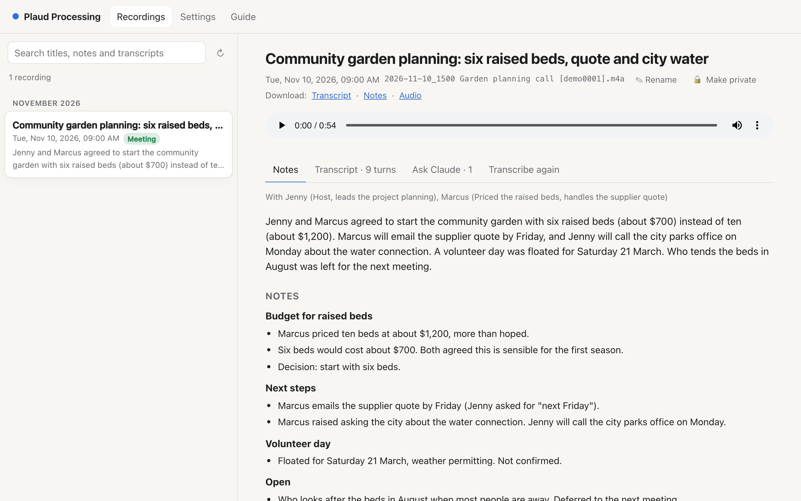

# Plaud Processing

Your Plaud recordings, transcribed on your own Mac.

New recordings come down from your Plaud account into a Dropbox folder on their own. Your Mac then transcribes them on its own, with speaker labels, and Claude writes notes from each transcript: a summary, action items, decisions, dates and more. A local web page lets you read, search, play and correct them, and ask Claude to do more with any recording. The transcripts and notes also sit next to the audio in Dropbox, so you can read them on any device.



```
 Plaud recorder ──► Plaud app ──► Plaud cloud
                                      │  plaud-sync, every 5 minutes (your Plaud login)
                                      ▼
                 Dropbox folder on your Mac  ◄── or drop in any audio file yourself
                                      │
                                      │  transcribe.py: Whisper or Parakeet + pyannote,
                                      │  on the Mac's GPU. The audio never leaves the Mac.
                                      ▼
                 <name>.transcript.txt / .json
                                      │
                                      │  Claude Code (`claude -p`, no tools): text only
                                      ▼
                 <name>.notes.md
                                      │
              ┌───────────────────────┴───────────────────────┐
              ▼                                               ▼
   Web page at http://localhost:8787               The same files in Dropbox,
   (and on your phone through Tailscale)           on your phone and other computers
```

## What you need

- A Mac with **Apple Silicon** (M1 or later). Transcription runs on its GPU; Intel Macs won't work.
- About **6 GB of free disk** for the models (downloaded once).
- [Homebrew](https://brew.sh) and **Node.js 20 or later** (`brew install node`).
- A **Plaud** account and recorder, for the automatic sync. Without it you can still drop audio files into the folder.
- **Dropbox** (optional, recommended): the folder syncs your audio, transcripts and notes to your other devices.
- A free **Hugging Face** account, for the speaker-identification model.
- **Claude Code** (optional), signed in with a Claude subscription or an API key, for the notes. Without it you get transcripts only.

## Install

```bash
git clone https://github.com/margulies/plaud-processing.git ~/plaud-processing
cd ~/plaud-processing
npm run setup
```

`npm run setup` walks you through everything, asking before it installs or signs in to anything: the folder, ffmpeg and uv, the Hugging Face login, the Plaud login, and the two background jobs (the server and the Plaud sync). It is safe to run again. When it finishes, open **http://localhost:8787**.

There are no npm packages to install: the server uses only Node's standard library, and the Python transcriber brings its own environment through `uv`.

**The full walkthrough, step by step, with what each step does: [docs/SETUP.md](docs/SETUP.md).**

## Everyday use

You don't need to do anything. Record on the Plaud and let the app upload it to Plaud's cloud as usual. Within about five minutes the audio is in your folder; a few minutes later it is transcribed (roughly 10 to 30 minutes per hour of audio, depending on the Mac and the model), and soon after that the notes are ready.

On the web page you can:

- **Read the notes**: summary, the write-up, your tasks and others', decisions, key points, dates, quotes, ideas, open questions. Every timestamp plays the audio from that moment.
- **Read the transcript** while the audio plays, the current line highlighted. Find words in it, name the speakers, correct a line.
- **Search** every recording's title, notes and transcript at once.
- **Ask Claude** anything about a recording, or pick a ready-made request: a clean transcript, minutes, a recap email, a blog post, key quotes, Q&A, study notes, a translation. Answers are kept with the recording.
- **Write the notes again**, reading the recording as a meeting, voice memo, talk or interview, with a note of your own for Claude.
- **Transcribe again** with another model, the number of speakers or the language. Earlier transcripts are kept, and you can go back to one.
- **Make a recording private**: it moves to the `Private` folder, is still transcribed on the Mac, and is never sent to Claude.
- **Download** the transcript, the notes or the audio.

The page has its own **Guide** (top right) that explains each of these.

## Claude, with your recordings

An MCP server lets the Claude desktop app and Claude Code work with your recordings when you ask: "What did Sam say about the deadline on Tuesday?", "List every task that's mine from this week's meetings", "Name speaker 2 Priya and write the notes again as an interview", "Write minutes for this morning's call and save them with it". It reaches only your recordings, never private ones, and can't delete anything.

```bash
npm run mcp:install
```

Details, the tools, and setting it up by hand: [docs/MCP.md](docs/MCP.md).

## Where things are

| | |
|---|---|
| Recordings, transcripts, notes | The folder you chose (in Dropbox): `<name>.m4a`, `<name>.transcript.txt`, `<name>.transcript.json`, `<name>.notes.md` |
| Private recordings | `Private/` inside that folder |
| Earlier transcripts | `.transcripts/` (hidden) inside that folder |
| Speaker names, notes data, Claude's answers, settings | `.processing/` (hidden) inside that folder |
| The folder and port | `.env` in this project folder |
| Plaud login and sync history | `~/.plaud/` |
| Logs | `~/Library/Logs/plaud-processing/` |
| Models | `~/.cache/huggingface/` |

Because everything about your recordings lives in the one folder, a new Mac pointed at the same Dropbox folder picks up where the old one left off. Run the server on **one Mac at a time**.

## Commands

```bash
npm run setup       # guided setup, safe to run again
npm run doctor      # what's installed and signed in, and how to fix each gap
npm run status      # are the background jobs running, last log lines
npm run restart     # restart the server (after an update)
npm run sync        # one Plaud sync now, in this window
npm run mcp:install # let Claude (desktop app, Claude Code) work with your recordings
npm start           # run the server in this window instead of in the background
npm run uninstall   # stop and remove the background jobs (your files stay)
npm test            # the tests (no models, no Claude, no Plaud)
```

Updating: `git pull && npm run restart`.

## Documentation

- [docs/SETUP.md](docs/SETUP.md): installing, step by step
- [docs/HOW-IT-WORKS.md](docs/HOW-IT-WORKS.md): each stage of the pipeline, the files, the models
- [docs/ACCESS.md](docs/ACCESS.md): reading your recordings on the phone and other computers
- [docs/MCP.md](docs/MCP.md): Claude, with your recordings
- [docs/PRIVACY.md](docs/PRIVACY.md): what stays on the Mac, what goes where
- [docs/TROUBLESHOOTING.md](docs/TROUBLESHOOTING.md): when something doesn't work

## Privacy in one paragraph

Audio never leaves your Mac except through the services you already use: Plaud's cloud (where the recorder uploads it) and Dropbox (if your folder is there). Transcription happens entirely on the Mac. Only the **text** of a transcript goes to Anthropic, through Claude Code, when notes are written or you ask Claude something, and never for recordings in the `Private` folder. Turn automatic notes off in Settings if you prefer to choose each time. If you connect Claude through MCP, what it reads in a conversation goes to Anthropic the same way. Details: [docs/PRIVACY.md](docs/PRIVACY.md).

## Credits

Transcription uses [mlx-whisper](https://github.com/ml-explore/mlx-examples) (OpenAI's Whisper on Apple's MLX), [parakeet-mlx](https://github.com/senstella/parakeet-mlx) (NVIDIA's Parakeet), and [pyannote.audio](https://github.com/pyannote/pyannote-audio) for speaker identification. Notes use [Claude Code](https://claude.com/claude-code).

This project is not affiliated with or endorsed by Plaud, Dropbox or Anthropic. It uses Plaud's own command-line login and developer API to fetch your recordings; whether that keeps working is up to Plaud.

## License

MIT. See [LICENSE](LICENSE).
